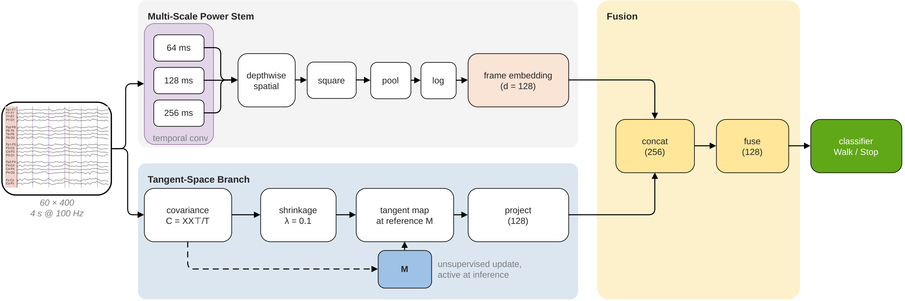
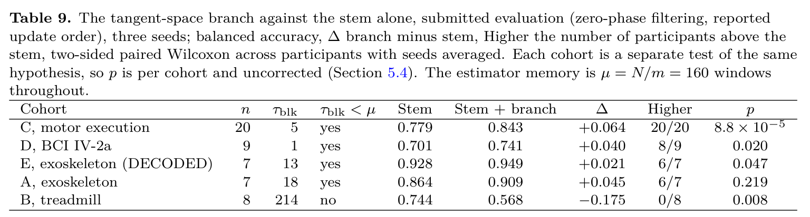
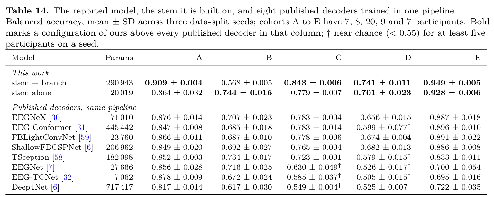
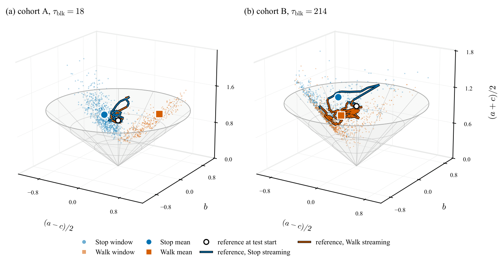
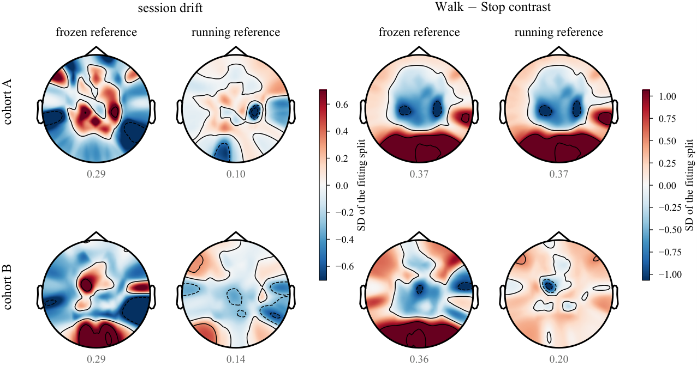

# CALM-Net

## Adaptive tangent-space features for cross-session EEG movement-intent decoding under temporally structured test streams

PyTorch code, configurations and results for the paper (Journal of Neural Engineering, under review).

## Network architecture



A multi-scale log-power stem is augmented with an adaptive tangent-space branch. Each window's
shrinkage-regularised covariance is mapped to the tangent space at a running reference **M**,
which is updated from incoming EEG without labels, also at test time. The branch is useful
when the reference memory μ (batch size N divided by update rate m) is longer than the
stream's median single-class block τ<sub>blk</sub>; when it is shorter, the reference follows
the class instead of the session drift and accuracy drops (cohort B).

## Requirements

Python 3.10+ and `pip install -r requirements.txt` (PyTorch, MNE, braindecode, moabb).

## Datasets

| Cohort | Dataset | Task | n |
|---|---|---|---|
| A | [OpenNeuro ds007788](https://openneuro.org/datasets/ds007788) | exoskeleton walking vs standing, sessions weeks apart | 7 |
| B | MoBI treadmill BCI, Luu et al. ([doi](https://doi.org/10.1038/s41598-017-09187-0)) | treadmill walking vs standing | 8 |
| C | [PhysioNet EEGMMIDB](https://physionet.org/content/eegmmidb/1.0.0/) | motor execution vs rest | 20 |
| D | BCI Competition IV-2a / BNCI2014-001 ([doi](https://doi.org/10.3389/fnins.2012.00055)) | left vs right hand imagery, two days | 9 |
| E | DECODED, EUROBENCH ([doi](https://doi.org/10.1038/s41597-023-02243-7)) | exoskeleton walking with motor imagery vs standing | 7 |

Place the data under `datasets/` (or set `CALMNET_DATA`):

```
datasets/ds007788/              BIDS dataset
datasets/mobi_treadmill/        SL01-T01/ ... (eeg.txt, joints.txt, conductor.txt)
datasets/eegbci/MNE-eegbci-data/files/eegmmidb/1.0.0/   (mne.datasets.eegbci)
datasets/decoded/dataset.zip    (or set DECODED_ZIP)
```

Cohort D is downloaded by moabb into `MNE_DATA`.

## Usage

```bash
# stem and stem + branch, three seeds
python train.py --config config/cohortA.yaml

# fully causal processing (forward-only filters, causal reference update)
python train.py --config config/cohortC.yaml --causal-filter --causal-update

# reference memory mu = N / m, here N = 4, m = 1 (mu = 4 windows)
python train.py --config config/cohortC.yaml --arms stem_tangent --batch 4 --momentum 1.0

# a published decoder in the same pipeline
python train.py --config config/cohortD.yaml --arms bd:EEGNeX

# every experiment in the paper
bash scripts/run_all.sh

# statistics, cost and figures from the stored results (no training)
python -m analysis.stats
python -m analysis.cost
python make_figures.py
```

Each run writes `results/<out>.json` (cohort means and per-participant values) and, per
participant and seed, `model.pth`, the training curve, the confusion matrix and the test
metrics under `results/runs/`.

## Results





The running reference on the covariance cone. On cohort A (18-window class blocks) it stays
in one place as the classes alternate; on cohort B (214-window blocks) it moves to whichever
class is streaming:



What the running reference removes: on cohort A the session drift (SD 0.29 to 0.10) while
the Walk-Stop contrast is kept (0.37); on cohort B much of the contrast as well (0.36 to 0.20):




## License

MIT
